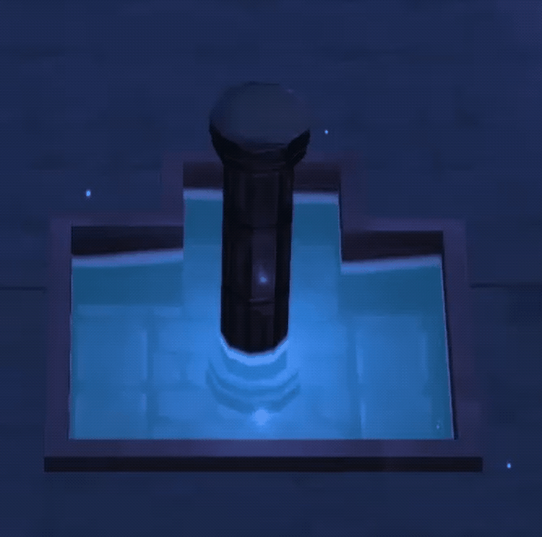
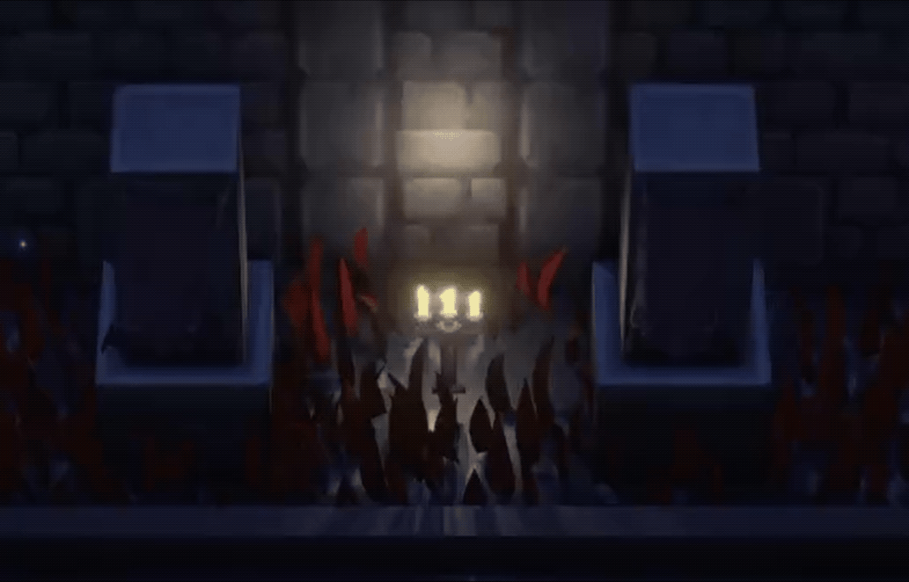

# Lunala and the Celestial Tower — Environment & Shader Work

A focused portfolio breakdown of my contributions to **Lunala and the Celestial Tower**, a top-down action RPG developed as a team project in Unity.

This repository highlights my **level design** and **custom shader** work. The animated previews below are included in the repository, so they play directly in the GitHub README.

## Shader previews

### Water shader

A transparent water surface with animated vertex movement, depth-based fading, a foam edge, and screen-space background distortion for a refraction-like effect. The shader samples a noise texture to animate the water.

Source: [`Shaders/water.shader`](Shaders/water.shader) · Camera depth setup: [`Shaders/CameraFetch.cs`](Shaders/CameraFetch.cs)

### Grass shader

A vertex-animated grass shader. A scrolling wind texture drives the motion, while vertex height controls how strongly each point bends so the base stays more stable than the tips.

Source: [`Shaders/Grass.shader`](Shaders/Grass.shader)

## My contribution

- Designed and assembled game environments and level layouts.
- Built custom animated water and grass shaders in Unity ShaderLab.
- Set up camera depth sampling for the water shader.

## Project context

Players control Lunala as she ascends the Celestial Tower, fighting enemies, using abilities, and upgrading between floors. The project was developed in Unity. My focus was on environment/level design and shaders.

